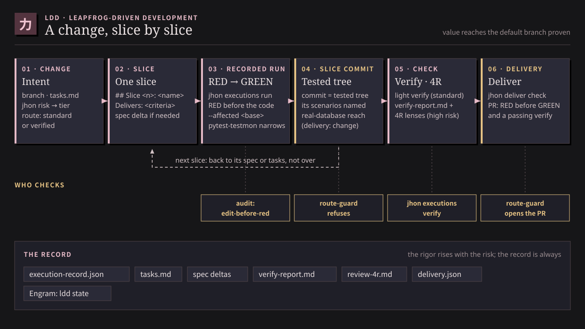
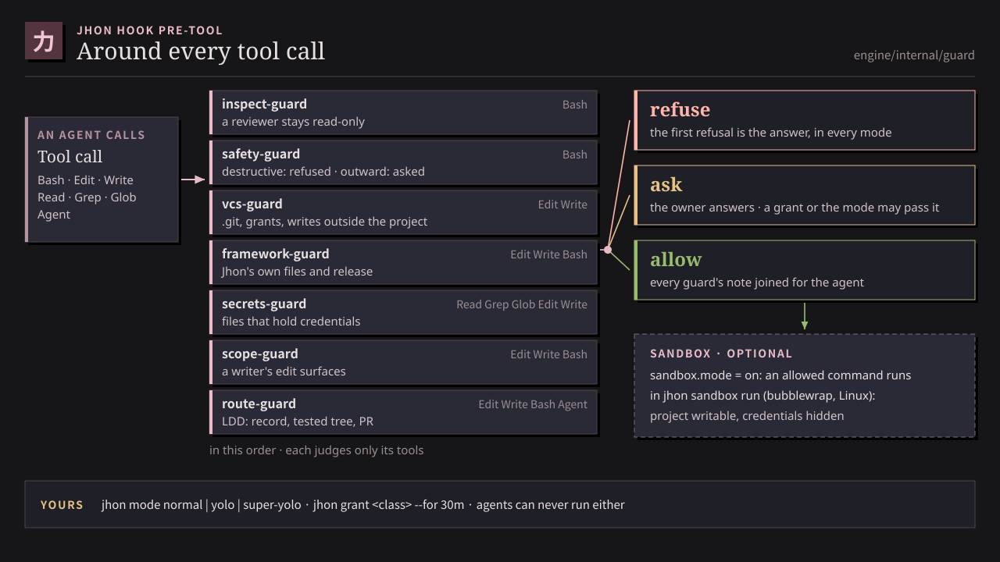
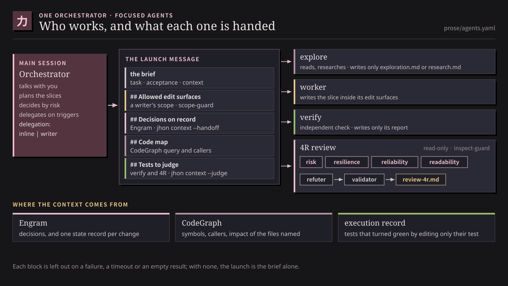

<p align="center">
  
</p>

<h1 align="center">Jhon</h1>

<p align="center">
  <b>Let the agent run. Deliver only what is proven.</b><br>
  An agent framework for Claude Code and pi.
</p>

<p align="center">
  <a href="LICENSE"></a>
  <a href="https://github.com/jachavarro2004/jhon-agent/actions/workflows/validate.yml"></a>
  <a href="https://github.com/sponsors/jachavarro2004"></a>
  <a href="https://github.com/jachavarro2004/jhon-agent/stargazers"></a>
</p>

### ▶ The presentation (3:39)

https://github.com/user-attachments/assets/e5d924c2-0a05-4a5f-82a9-1ab303276258

<details>
<summary>With Spanish subtitles</summary>

https://github.com/user-attachments/assets/0ae10efb-b546-4f5c-be7d-87e6415f27fa

</details>

Full resolution: [English](https://jachavarro2004.github.io/jhon-site/assets/video/jhon-explainer.mp4) · [Spanish subtitles](https://jachavarro2004.github.io/jhon-site/assets/video/jhon-explainer.es.mp4)

The teaser (1:13): [English](https://jachavarro2004.github.io/jhon-site/assets/video/jhon-teaser.mp4) · [Spanish subtitles](https://jachavarro2004.github.io/jhon-site/assets/video/jhon-teaser.es.mp4)

---

## Why Jhon

A coding agent left alone is either asked about everything or trusted with
everything. Jhon takes a third way: the agent gets **freedom of execution
within safety limits**, and **nothing is delivered without evidence**.

- **The limits are code, not advice.** Guards judge every tool call of
  every agent. A destructive command is refused, an outward-facing one is
  asked, and you can widen what passes with a mode or a timed grant.
- **The evidence is a record.** A change's test fails first (RED) and passes
  after (GREEN) in a recorded run; the commit that closes a slice is the
  tree that run tested; a verify comes before the pull request. A change
  without that record does not get its pull request opened.
- **The method is LDD**, Leapfrog-Driven Development
  (`prose/contracts/ldd.md`): value reaches the default branch in
  integrable, proven slices, with no ceremonies, and every rule stays only
  while the evidence backs it.

### What Jhon is

| Part | What it does |
|---|---|
| One orchestrator | The main session. It talks with you, plans the slices, reads the risk, and decides when to delegate. |
| Focused agents | `jhon-scout`, `jhon-builder`, `jhon-checker` and the Prism reviewers, each with its own tools and a launch message that carries what it needs. |
| Guards | Seven checks on every tool call, the same in both runtimes, run by one binary. |
| LDD | The delivery method: slices, recorded test runs, the slice commit and delivery checks. Always on. |
| Memory and the code map | Engram keeps decisions and each change's state; CodeGraph gives agents the code's symbols and callers. Both always on. |
| The `jhon` binary | The engine under both runtimes: the CLI, every hook, the records, the renderer, the audit and the sandbox. |

### What Jhon is not

- **Not a runtime or a model.** It runs inside Claude Code (`jhon start`)
  or pi (`jhon start pi`). Claude Code runs Claude; pi runs Claude or
  another provider, as the model profile says (`jhon profile`).
- **Not a change to your own setup.** A plain `claude` stays standard, and
  your global Claude Code settings and CLAUDE.md stay yours. Your own pi
  directories stay yours too: Jhon's pi lives in `.pi/jhon` in the home.
- **Not process or network isolation.** Each enforced rule holds on the
  surface its hook reads; a program that acts on its own is outside it. The
  OS sandbox (Linux, on by default there where it can run) narrows what a
  command can write and see, with no network isolation.
- **Not CI.** It records and checks evidence on your machine; your CI still
  runs on the pull request.

## A session, from your side

1. You start Jhon in a project: `jhon start` (Claude Code) or
   `jhon start pi` (pi).
2. You ask for something. Read-only work just happens. At the first code
   change in a project with no LDD layout, the session asks you once how
   to deliver and test, sets LDD up, and goes on.
3. The orchestrator outlines the change in slices, and for each one gets a
   failing test recorded, the code written, and the affected tests recorded
   green. It does small work itself and hands the rest to focused agents.
4. Guards judge every tool call on the way. What they refuse stays
   refused; what they ask, you answer, or your mode and grants answer for
   you.
5. A verify checks the slice. The pull request opens only with RED before
   GREEN and a passing verify of the tree the last run tested.
6. Afterwards, `jhon audit` reads the session for what went wrong, and the
   dashboard shows sessions, changes and usage.

## LDD: how a change reaches the default branch



Jhon always works under LDD; there is no switch to turn it off. A project
keeps its record in `openspec/` or in a native `ldd/` of the same shape
(see [docs/ldd.md](docs/ldd.md)).

| Step | What happens | The command |
|---|---|---|
| Intent | Why the change exists and its acceptance criteria; a tasks.md, when there is one, outlines every slice (`## Slice <n>: <name>`, `Delivers:`). The risk tier sets the route. | `jhon risk`, `jhon status` |
| RED | A failing test, recorded before the code. | `jhon executions run <change>` |
| GREEN | The code, then the affected tests, recorded. A pytest project is narrowed by pytest-testmon; `jhon executions prime` builds the missing records. | `jhon executions run <change> --affected <base>` |
| Slice commit | Under `delivery: change`, the commit that closes a slice must be the tree its last run tested. | checked by `route-guard` |
| Verify | A light verify by the `jhon-checker` agent on the standard route; a full `verify-report.md` and the Prism facets at high risk. | `jhon executions verify <change> --verdict pass` |
| Delivery | Ready when the tree is clean and HEAD's tree is the last passing run's. The pull request opens only with RED before GREEN, and a passing verify on the verified route. | `jhon deliver check <change>` |

**The rigor rises with the risk.** `jhon risk` reads a tier (passive,
medium, high) from the paths a change touches, and the route follows it:

| Route | When | Verification | Prism review |
|---|---|---|---|
| `standard` | risk under the verified tier, whatever its size | the affected tests of each slice; a light verify is an advisory | when you ask, or `review_required` names it |
| `verified` | risk at the verified tier (`high`), or `review_required` names `checker` | an independent verification before delivery (`verify-report.md`) | automatic, with only the pertinent facets |

**What the slice commit is checked for**, under `delivery: change`:

| Check | Refuses a slice commit when |
|---|---|
| Tested tree | the commit is not the tree the last test run tested, or that run was a unit's run (a bare `--affected`) |
| Scenario coverage | a scenario the slice adds or edits in the change's spec deltas is named by no test (a scenario copied unchanged into a MODIFIED block does not count) |
| Real-database reach | the slice changes a declared data-access file (`executions_data_access`) and no declared real-database test (`executions_database_tests`) of its recorded run reached it in pytest-testmon's record (with no record, the run and `jhon status` say the reach could not be checked) |

A test that turned green while only its own test file changed is never
refused: it is marked in the record and handed to `jhon-checker` and the Prism review
facets to judge whether it was weakened.

## Guards: around every tool call



Every Jhon agent, the main session and each sub-agent, runs its tool calls
through `jhon hook pre-tool`. Each guard judges only its tools, in this
order; the first refusal answers, otherwise the first ask, otherwise the
call passes with every guard's note joined. Each guard carries a card: the
risk it covers and the real case that put it there (`jhon audit --all`
counts what each one costs).

| Guard | Judges | Covers |
|---|---|---|
| `inspect-guard` | Bash | a reviewer changing what it reviews: Prism reviewers stay read-only |
| `safety-guard` | Bash | a destructive or irreversible command (refused), a write or delete of a credentials file (refused), an outward-facing one without your consent (asked), a sub-agent's unbounded wait; a read, a write outside the project or one it cannot resolve is not limited (the sandbox bounds it) |
| `vcs-guard` | Edit, Write | a write into `.git/` or the grants, an agent writing Claude Code's settings, a write outside the project (asked at the top level); `jhon-scout`'s write beyond its record runs with a note |
| `framework-guard` | Edit, Write, Bash | an agent editing Jhon or its installed release while it runs on it (Edit, Write), or running Jhon's own code by hand (Bash); a Bash write or git there is the sandbox's, where they are read-only |
| `secrets-guard` | Read, Grep, Glob, Edit, Write | a file that holds credentials (`.env`, keys) or a home credentials directory; a template such as `.env.example` passes |
| `scope-guard` | Edit, Write, Bash | a writer editing outside the edit surfaces its handoff names; a shell write whose target it cannot resolve runs with a note |
| `route-guard` | Edit, Write, Bash, Agent | LDD: a writer launched without its scope or with a surface that matches nothing, a change without its record, a slice commit of an untested tree, a PR without its docs, a merge without rebase, a command that moves the default branch (a merge, a pull, a reset or rebase on it, a local fetch or push refspec, `update-ref`, `symbolic-ref`, `branch -f`, `checkout -B`, `worktree add -B`) to a commit no ready `jhon deliver check --action merge` covers, and a command that turns off git's merge gate (`hook.jhon-merge-gate`, the reference-transaction hook it writes into an LDD repository's git configuration, so git itself refuses such a move when the agent's git makes it, never the owner's: it reads `JHON_AGENT=1`, which only the agent's commands carry, and route-guard refuses a line that drops or sets it, never one that only reads or searches for it; an agent that strips its own environment by means a line cannot show, a script, a program it starts or `eval` of a built string, is outside what a line or a hook can stop, as is a remote-tracking ref forged in one step and merged in another; `jhon audit` reports such a move only when the line itself writes it; the owner's git pays only the hook's start, about 25-40 ms on a commit or a checkout); a code edit before LDD is set up runs with a note |

A file an agent writes is then formatted by its project's own formatter
(`jhon hook format-edit`). On Linux `sandbox.mode` is on by default where
the sandbox can run (one empty sandbox starts); where it cannot (no
bubblewrap, user namespaces off or blocked by AppArmor, a bubblewrap too
old or without `--bind-fd`, a kernel or seccomp filter without `openat2`) the default is off, commands run unsandboxed and `jhon doctor` warns
with the fix (an explicit `on` there refuses every command). A probe that
does not end within 5 seconds is no verdict: the mode stays on, commands are
wrapped as usual and fail with bubblewrap's own message if it cannot start,
and `jhon doctor` warns. With it on, an
allowed command runs inside `jhon sandbox run` (bubblewrap): the project, the
temporary folders, the caches and `sandbox.allow_write` are writable,
everything else is read-only, and the home's credentials are not there.
Each folder it binds is opened last with no link followed (`openat2`) and
handed to bubblewrap as a descriptor (`--bind-fd`, `--ro-bind-fd`), so a
folder another sandboxed run swaps for a link after Jhon checked it is not
followed; one changed before that refuses the run, and without `openat2`
(Linux before 5.6, or refused by a seccomp filter) the run fails closed.
A writable folder is opened only through the path Jhon checked, the
project only once it is the folder the command runs in (or the one
`--project` names, with no link on it), and no descriptor the caller left
open reaches the program. bubblewrap still mounts by path, so the program
starts through a hidden internal step of jhon's (`sandbox enter`), run
from jhon's own program, which checks inside the sandbox that each mount is the folder
Jhon checked (device and inode, a mount root, read-only where it should
be, the hidden paths too) and only then becomes the program; a mismatch
runs nothing (exit 126). The pinned project (`jhon start`, pi's pin,
Claude Code's hook) is taken only as the folder it names with no link on
it, so a swap while it is read pins nothing else.
Jhon's source checkout, the one `jhon sync` installs from, stays read-only
unless it is the project itself: a linked worktree of it is another project,
and writes only its own files (and commits through the checkout's git
folder). A
line of git network commands (fetch, pull, push, ls-remote, clone, remote
update) working inside the project, or gh, runs outside the sandbox, still
judged by the guards: git over SSH and gh cannot run inside it. The line may
open with `cd <folder> &&` into the project and name gh's `{owner}` and
`{repo}`; anything else on it (a pipe, `$(…)`, another command) keeps it in
the sandbox, and when such a line fails it ends with a note saying so. A git
repository inside a `sandbox.allow_write` folder counts as the project for
such a line of git and gh (a second repository you work on from the
project's session; docker and the deploy tools below run outside only from
the project):
`git -C <repo> fetch`, `cd <repo> && git pull`, a push run in it, all run
outside the sandbox with the same checks the project's lines get (its git
configuration, its git folders, the clean PATH, the wait for sandboxed
commands below), once the repository is named with no link and no `..` on
the way and is, with no link followed, the folder Jhon judged; gh run in
the repository is its line too. A line that works in two repositories, or
in one the sandbox does not open for writing, stays inside, and so does a
project line whose folder goes up with `..` after a link (git goes up from
where the link leads) or whose `cd` or `-C` folder is or passes through a
link (its note names the real path). Any line that runs outside runs only in the folders
Jhon checked: once no sandboxed command can change them, every folder it
runs in, names with `-C` or `cd`, or clones into is opened again as git
reaches it, with no link followed, and must still lie in the project or the
repository; one moved, or made a link, after Jhon read the line keeps it
inside. That check reads the disk anew, never a fact read before the line
waited (a clone's new folder is followed part by part, as it is then). An
`allow_write` folder that is a
link counts for nothing; the note says to set the real folder. A line kept
inside for any reason but its shape ends, when it fails (git's exit 255 on
a read-only folder included), with that reason and what you can do, and
one that is already alone is not told to run alone (`git over SSH and gh ran in
the sandbox, not outside it: <folder> is neither in the project (<project>)
nor in a git repository inside a sandbox.allow_write folder; fix: …`). A line
of docker or docker-compose, the owner's deployment tool, also runs outside
the sandbox, with the owner's environment (`DOCKER_HOST`, the docker context) and its volume
mounts not judged; `docker login`, `docker logout` and a change of docker
contexts keep the sandbox, and so does a docker configuration folder
(`--config`, `DOCKER_CONFIG`), its `cli-plugins` or a plugin folder its own
configuration file lists that a sandboxed command may change: docker would
load a plugin planted there outside the sandbox. The programs you list in `sandbox.deploy_tools`
(empty by default; `jhon settings set sandbox.deploy_tools aws,cdk,sam`,
`""` empties it; the shells, wrappers, terminals, editors, interpreters,
remote shells and script runners Jhon knows, such as `bash`, `env`, `sudo`,
`python3.12`, `ssh`, `vim` or `npx`, are refused, and a name it does not know is
taken, so list only deploy tools) run outside the sandbox the same way, so a deploy finds
your cloud credentials (the AWS ones) and the rest of your environment: on a line of their own, or with
other programs that run outside, with no pipe to another program, redirect to a file, `$` or
backtick, and taken from a PATH folder a sandboxed command cannot write;
such a line gets a PATH without the project's folders, the folders of any
other git repository (its work tree, its git folder, its `<root>-worktrees`,
which that project's sandboxed commands write) and every other
folder a sandboxed command may change, so a program planted there is never
what git, gh, docker or a deploy tool runs by its name;
anything else on the line keeps it in the sandbox, and such a line ends, failed
or not, with a note that the tool runs outside the sandbox only on a line of
its own (`aws sts get-caller-identity --region us-east-1`, not `export
AWS_REGION=…; aws … | tail -1`). The agent's always-on text says the same
before it runs anything: a failure inside the sandbox is fixed by running the
program alone, not by turning the sandbox off. That git
runs with the repository's hooks (configured hooks included), ssh command,
fsmonitor and credential helpers overridden, and it runs outside only while
every key the repository's own configuration sets (with its worktree
configuration and what they include) is on a short allowlist: the format
keys, a remote's url, refspecs, tag option and prune, a branch's remote,
merge and rebase, your name, email and signing switches and key, the pull,
push and fetch defaults, and Jhon's merge gate. A repository that sets any
other key (`http.cookieFile`, `http.proxy`, `url.*.insteadOf`,
`include.path`, a filter, `core.worktree`, a key git adds later) keeps the
line in the sandbox: a sandboxed command could have written it, and a list of
the keys that run a command or write a file was broken twice. Your own
git configuration (the system's, the global one, and every file they
include) is read only from files no sandboxed command may change: an include
from the cache, the project or `/tmp` keeps the line inside, as a command
could set a key there that runs a program (`core.gitProxy`, a filter). A
folder whose `.git` git refuses to read (a format it does not know) keeps the
line inside too, and a pull (or `gh pr merge --delete-branch`, which
checks out and pulls the default branch) runs outside only when no
`.gitattributes` or `.gitignore` in its work tree is anything but a regular
file: git would wait forever on a pipe there. A line whose
git folders lie outside the project, or hold a link, a hard-linked file git
writes (`FETCH_HEAD`, a reflog, a ref) or a FIFO, socket or device, or are
named with white space around them (git keeps it, a trimmed name would be
another folder), runs in the sandbox too, with a note: git would write
through it outside the sandbox, or wait on it. uv's tools go to a
sandbox-only folder under the cache, and uv's own tool folder in the home stays
read-only. A `sandbox.allow_write` folder that does not exist yet is
created before the next sandboxed command starts, outside the sandbox, so
you need not make it by hand: only under the home, with no link followed,
never in or around a path the sandbox hides or keeps read-only (the
credentials, Jhon's settings, state and releases, the runtimes' folders)
and never a PATH folder or one that holds one, nor through a parent that
breaks those rules; its parents stay read-only. A writable area named
inside another one (an `allow_write` folder in the project or `/tmp`, a
`$TMPDIR` or a cache a variable names under `/tmp`) gets no mount of its
own, and no writable area, the project's own folders and `<root>-worktrees`
included, is bound when it is or passes through a link (only the home's own
way, as `$HOME` is written, is yours; another link that leads to the home is
a link): name the real path, the folder the link leads to,
as `jhon sandbox status` and the note on a refused write say. An
`allow_write` folder that is or holds Jhon's release, the `jhon` program,
the source checkout, Jhon's protected files, a PATH folder or the folder a
link in one leads to (~/.local/bin/claude into ~/.local/share/claude)
stops every sandboxed command with the fix: name a concrete subfolder such as
`~/.local/share/<app>`. A default cache or store under the home (the cache, gradle's
folder, go's module cache and the like) that holds a PATH folder is not
writable inside the sandbox; status names it with the fix (move the tool's
bin out of the cache, or take it off PATH). `/tmp` and `$TMPDIR` are not
judged so. A cache or store wherever a variable puts it
(`GOMODCACHE=~/.local`) that holds Jhon's release, the `jhon` program, the
source checkout or Jhon's protected files, where a command could rename a
folder around them, is not writable either; status and doctor name it with
the fix (point the variable at a folder that holds none of them).
`jhon sandbox status` says which ones the next command creates and why
Jhon will not create any other. A command that fails on a read-only
path ends with a note telling the agent to stop and name the path: whether
it exists and why it is read-only, with the setting that opens it
(`sandbox.allow_write`) or that none does (a PATH folder, Jhon's own files,
a hidden path, a file directly in the home, a path outside it), control
characters in the path escaped, and each run records a `jhon.sandbox`
telemetry event. Everything inside the sandbox sees `JHON_IN_SANDBOX=1`:
`jhon sandbox status` run there, where no other sandbox can start, says it
runs inside and that the status outside it gives the real state (`inside` and
`can_run` true in `--json`), instead of reporting bubblewrap's failure. Each
command runs in a PID namespace of its own, so when it ends every process it
started inside the sandbox ends too, one it detached (`setsid`, `nohup`, a
double fork) included. While a sandboxed command that can write a project
runs, a line of that project that would run outside the sandbox (git, gh,
docker, a deploy tool) waits up to 3 seconds and is then refused with a note:
such a command could otherwise change what the outside line reads (the
repository's git configuration) while it reads it; and while such a line
runs, a sandboxed command that can write its project waits and is refused the
same way. A line that puts anything in the background (`&`, a coprocess)
never runs outside the sandbox, as it would outlive that check, and the
program a line outside starts ends with the jhon that runs it, killed or
not (one that program starts in turn is not reached). A
long-running sandboxed command (a dev server in the background) therefore
holds the project's `git push` until it ends, and a long deploy holds the
project's sandboxed commands. Docker's and podman's sockets are hidden inside
the sandbox: through one a container can write anywhere you can and outlive
the command. `jhon settings set sandbox.docker true` shows them again, and
`jhon sandbox status` and `jhon doctor` then name it as an escape you
accepted; with it off no docker or podman socket is there at all, the
system's (`/run/docker.sock`, `/run/podman`), Docker Desktop's under
~/.docker and any unix socket `DOCKER_HOST`, `CONTAINER_HOST` or a docker
context names. herdr's sockets (its API runs commands in its panes), the system
bus, sshd's local socket and the pi harness's socket folder are hidden too.
With
`sandbox.mode = "on"` set and a sandbox that cannot run (no bubblewrap,
user namespaces off) every command is refused with the fix and `jhon
doctor` fails; `sandbox.mode = "off"` turns it off. Off, nothing guards a shell command's
writes outside the project: the guards leave them to the sandbox, so a
redirect, `dd`, a recursive `chmod` or a write to Jhon's installed files or
source there runs, and on Linux `jhon doctor` warns. macOS and Windows run
unsandboxed (off by default there) with a `jhon doctor` warning. See
`jhon sandbox --help`.

### What each runtime guarantees

Not every rule is enforced. `prose/agents.yaml` (`guarantees`) states, per
rule and runtime, how it holds, and `jhon doctor --runtime <name>` prints it:

| Runtime | Enforced (a hook refuses) | Behavioural (`jhon audit` checks after) | Instruction only |
|---|---|---|---|
| Claude Code | 5 | 13 | 4 |
| pi | 5 | 13 | 4 |

The enforced rules are the safety guard's destructive and outward-facing
rules, the framework boundary, a writer's scope, and the tool list a
sub-agent gets; `jhon-scout`'s writes beyond its record run with a note, which
`jhon audit`'s scout-wrote reads. pi has no runtime isolation, so `jhon audit`
reads a pi `jhon-builder` or `jhon-checker` child's write outside its own tree; that check,
like test-weakened, checker-wrote, and archive-without-red, reports a
would-be violation until real fixtures back it.

## Agents: one orchestrator, focused helpers



The orchestrator keeps the conversation and the plan. Propose, spec,
design, tasks, init and archive run inline in it; three executors carry
every LDD step that leaves its thread. Its delegation mode is the
profile's: `inline` (the default: it builds only a small change itself; a change
`jhon status` calls not small goes to builders, a slice each, exploration
past one read batch to the scout, and it also delegates when that is cheaper
or runs in parallel) or `writer` (builders write; it edits at
most about 20 lines per request).

| Agent | Does | Writes |
|---|---|---|
| `jhon-scout` | investigates before a change: the code, prior decisions, approaches, outside evidence | only its change's exploration.md or research.md (another write runs with a note) |
| `jhon-builder` | builds a slice, or one layer of it | only the edit surfaces its handoff names |
| `jhon-checker` | checks a slice or a change independently, from tests that actually ran; fixes nothing | only verify-report.md |
| Prism facets (`prism-safety`, `prism-failure`, `prism-clarity`, `prism-behavior`) | review a frozen diff through four facets: safety, failure, clarity and behavior; then `prism-challenger` tries to refute each finding and `prism-arbiter` confirms the ones that stand | nothing: the verdict goes to `review-prism.md` |

In pi the Prism review runs natively in one tool call (`jhon review start`, then
every pertinent facet at once, then the challenger and arbiter, then
`jhon review record`); in Claude Code, `jhon review run` does the same in
one Bash call through `claude -p`. The `prism-*` facet agents are its fallback.

**What each launch carries.** A sub-agent's first message is its brief,
followed by what Jhon found for it, each block left out on any failure,
timeout or empty result:

| Block | From | For |
|---|---|---|
| `## Allowed edit surfaces` | the orchestrator | a writer: its scope, which `scope-guard` holds it to |
| `## Decisions on record` | Engram, through `jhon context --handoff` | every sub-agent |
| `## Code map` | CodeGraph: `query` and `callers` for the files and symbols the brief names | every sub-agent, where the project has a `.codegraph/` index |
| `## Tests to judge` | the execution record, through `jhon context --judge` | `jhon-checker` and the Prism facets |

**Memory.** Engram holds decisions, and the engine keeps one state record
per change in it (phase, slices, last run, delivery, code refs), written
after a slice commit, a light verify and an archive, never failing the
step. Inside the sandbox Engram's folder stays read-only, so the record is
queued in the repository's git common dir and the next jhon command outside
the sandbox (the agent's next tool call) saves it; only well-formed state
records of Jhon's own are saved, anything else is refused and reported
([docs/ldd.md](docs/ldd.md)). Claude Code's project memory is shared by both runtimes.

## Measured, not assumed

Every rule is a hypothesis with its evidence, and the evidence is measured.

- **`jhon audit`** reads a Claude Code or pi session afterwards for
  safety and delivery outcomes: `refusal-bypass`, `isolation-bypass`,
  `delivered-untested`, `edit-before-red`, and `inline-not-small` (the
  main agent writing a change itself after `jhon status` called it not
  small). It also measures context use,
  each change's slices and time, each writer's efficiency, how each agent
  used memory and CodeGraph, and your dialogue with the main thread, as
  statistics. `--all` sums every recent session; `--html` gives one page.
- **Rounds.** After a user story or a few sessions, `jhon audit --all`
  sets out the numbers, a short proposal says what to remove, adjust or
  add, and you decide. A guard that pays for nothing is a candidate to go.
- **The bench** (`tools/bench/README.md`, maintainer only) runs the same
  synthetic tasks with Jhon and without it, in both runtimes (`jhon`
  against `clean` Claude Code, `pi-jhon` against `pi-clean`), and judges
  Jhon by equal or better quality and better discipline, with the extra
  cost shown. `bench review-compare` gated the native Prism review: on five fixtures
  with seeded defects it found the same 9 of 9 known defects as the facet
  agents for about 3.4× fewer quota-weighted tokens and 2.7× less wall time.

## Where you work


| Place | How you open it | What you get |
|---|---|---|
| Claude Code | `jhon start` | `claude --agent jhon-orchestrator` with the release's plugin: the `/jhon-ldd` command and the read-only `jhon` MCP server (audit, status). Every other argument goes to claude; resume with `jhon start --resume <id>`. Your claude.ai connectors stay out unless `claude_code.connectors` is on. |
| pi, with Jhon's shell | `jhon start pi` | pi on Jhon's own agent directory with `jhon-shell`: the orchestrator, the sub-agents, the guards, and the shell's UI in rose ink. The first start installs the pinned pi packages. |
| The dashboard | `jhon dashboard`, or `/jhon:dashboard` in the shell | A read-only page on http://127.0.0.1:7480: Home, Sessions (each with its audit), Changes, Usage (tokens per day, money where pi recorded it, never estimated), Memory (Engram and MEMORY.md, read only) and Telemetry. |
| The audit | `jhon audit <session>`, `jhon audit --all` | What a session did against the rules, read-only; exit 1 only on a verified violation. |

The shell talks to Jhon only through the binary (`shell/CONTRACT.md`).
Its commands:

| Command | Key | Shows |
|---|---|---|
| `/jhon:status` | `alt+j` | the change's LDD detail |
| `/jhon-ldd <action>` | | an LDD action, as in Claude Code |
| `/jhon:agents` | `alt+s` | the session's sub-agents and each one's live thread |
| `/jhon:jobs` | `alt+o` | background commands and monitors |
| `/jhon:usage` | `alt+u` | each provider's subscription windows and resets: Claude and ChatGPT (openai-codex) from each reply |
| `/jhon:profile` | | the model profiles |
| `/jhon:grants` | | the project's grants |
| `/jhon:customize` | | the shell's settings, and the permission mode |
| `/jhon:video [<source>]` | | with `integrations.studio` on only: a presentation video of the project with jhon-studio (`/jhon-studio:video` in Claude Code; [docs/jhon-studio.md](docs/jhon-studio.md)) |

## You decide

The guards are fixed; how much passes without asking is yours. A mode and
a grant are set only by you: an agent may read the mode but never set it,
and never runs `jhon grant` (run them with `!` in Claude Code, or in your
own terminal in pi).

| Mode (`jhon mode`) | Passes without asking |
|---|---|
| `normal` | nothing beyond your live grants: the guards as they are |
| `yolo` | every grant class but `destroy`, and a Prism reviewer you did not ask for |
| `super-yolo` | that, plus `destroy` and a command the guard cannot read |

| Grant class (`jhon grant <class> --for 30m`) | Covers |
|---|---|
| `push` | a push to the default branch, of every branch, or of tags (a push to any other branch passes) |
| `gh-write` | a merge, a release, repository, secret and workflow writes (a PR's create, comment, ready and edit pass) |
| `publish` | a package publish (`npm publish`, `cargo publish`, …) |
| `remote` | a session on or a copy to another host (`ssh`, `scp`, `rsync`, …) |
| `deploy` | a cloud or cluster write (`aws`, `gcloud`, `kubectl`, `terraform apply`, …) |
| `outside-write` | an Edit or Write outside the project and the scratch roots, asked at the top level and refused to a sub-agent (a shell write there is the sandbox's) |
| `destroy` | a deletion that loses work (a forced branch delete, `reset --hard`); the rest of the destructive operations are never grantable |

**The hard lines, in every mode.** Refused: credentials (by the file tools; by the shell, a write or delete), the
never-grantable destructive operations, writes into `.git/`, the grants
and the modes, Jhon's own files. Asked: a write to Claude Code's settings,
and a `git config` that changes what git runs.

**Where they apply.** A git repository, with or without LDD, is a project:
it takes a mode and timed grants. A folder that is not a git repository is
no project: `jhon mode` and a timed `jhon grant` refuse there, as in HOME
and `/`, and its calls are judged as in normal mode. There, pi's question
about a write outside the project offers "Yes, and allow writes in this
folder for this session" (`jhon grant outside-write --session <id>`). That
grant covers the session's Edit and Write calls inside the folder (not
through a link out of it, nor into a nested repository), never HOME, `/`, a
folder above HOME or jhon's state, and nothing but `outside-write`; pi
revokes it at shutdown, and it ends after 12 h at the latest. In Claude
Code a yes covers that one call.

**Settings** are one file, `.config/jhon/settings.toml` in the home:
`jhon settings list` shows every key with its value and source,
`jhon settings get <key>` one of them, and
`jhon settings set <key> <value>` writes one and refuses a value the schema
does not accept; `jhon settings migrate` drops the keys a release removed,
after a backup. The main groups:

| Group | Holds |
|---|---|
| `[runtimes]` | `claude_code`, `pi`: which runtimes are installed (both by default, at least one) |
| `[integrations]` | `engram` and `codegraph` (always on), `context7` (hosted documentation for `jhon-scout` and `jhon-builder`, on by default), `studio` (jhon-studio, opt-in), telemetry (opt-in), the palette |
| `[sandbox]` | `mode` (`on` or `off`, on by default on Linux where the sandbox can run, off elsewhere), `allow_write` (a missing folder under the home is created for the next sandboxed command) |
| `[agents]` | `act_on_announce`: a turn that announces an action and takes none is sent back once |
| `[pi]`, `[shell.*]` | the active profile, and the shell's appearance, behaviour and keys |

**Integrations** beyond the core, each off until you turn it on:

| Integration | What it gives | How |
|---|---|---|
| [jhon-studio](https://github.com/jachavarro2004/jhon-studio) | presentation videos for any project: `/jhon-studio:video` in Claude Code, `/jhon:video` in pi | opt-in: `jhon setup`, or `jhon settings set integrations.studio true` and `jhon update`; either installs its newest signed release that supports this jhon; see [docs/jhon-studio.md](docs/jhon-studio.md) |

**Profiles** choose each agent's model per runtime (`jhon profile list`,
`jhon profile use <name>`); `default` is `prose/agents.yaml`. A pi model is
written `provider/model[@thinking]`, so a profile can run pi on Claude
through Claude Code (`claude-bridge`, the default), an API key, or another
provider. `jhon profile mode <profile> inline|writer` sets its delegation
mode. The agents' old names (explore, worker, verify, review-risk and
the other review-* agents) are still read in a profile for now, each with
a one-line warning naming its new name, as are `review_required` values 4r
and verify in a project's LDD config (now prism and checker); jhon settings
migrate rewrites both.

## Get started

**Needs:** Linux on amd64 or arm64, or Windows with WSL 2; git; Claude Code
(`claude`) for the Claude Code runtime; node for pi; engram and codegraph.
`jhon setup` checks each one and says how to fix a missing one.

| Step | Command |
|---|---|
| Install | `curl -fsSL https://raw.githubusercontent.com/jachavarro2004/jhon-agent/main/install.sh \| sh` (Windows, in PowerShell: `irm https://raw.githubusercontent.com/jachavarro2004/jhon-agent/main/install.ps1 \| iex`) |
| Set up | `jhon setup`: pick the runtimes and the opt-in integrations, check what they need, write the settings, install |
| Start | `jhon start` (Claude Code) or `jhon start pi` (pi), inside your project |
| Check | `jhon doctor`: every health check, no network call (`--remote` adds the remote ones) |
| Update | `jhon update` (verified: sha256 and the release's cosign keyless signature), `jhon update --check`, `jhon update --rollback` |
| From source | `jhon sync` in a checkout: builds a release from the committed HEAD and installs it |

**Turning off or removing.** A runtime turned off in `[runtimes]` is
skipped by the next install and its directory is left as is. Jhon has no
uninstall command; an install lives in the home under `.local/bin/jhon`
(the installer's link), `.local/share/jhon/` (the releases and `current`),
`.config/jhon/` (settings and profiles), `.local/state/jhon/` (grants and
modes), `.pi/jhon/`, and the agents in `.claude/agents/` that
`.claude/agents/.jhon-owned` lists.

Jhon's source, its releases and its installers (`install.sh`,
`install.ps1`) live in one public repository,
[jachavarro2004/jhon-agent](https://github.com/jachavarro2004/jhon-agent),
whose `.github/workflows/release.yml` builds, signs and publishes every
release (`test/install/README.md`). To verify a release by hand, with its tarball,
checksum and signature bundle in one directory:

```sh
sha256sum -c jhon-X.Y.Z-linux-amd64.tar.gz.sha256
cosign verify-blob \
  --bundle jhon-X.Y.Z-linux-amd64.tar.gz.sigstore.json \
  --certificate-identity "https://github.com/jachavarro2004/jhon-agent/.github/workflows/release.yml@refs/tags/vX.Y.Z" \
  --certificate-oidc-issuer https://token.actions.githubusercontent.com \
  jhon-X.Y.Z-linux-amd64.tar.gz
```

A signature from any other repository, workflow or ref is not Jhon's.

## Commands at a glance

`jhon help` is the full usage; `jhon <command> --help` gives a command's
own help.

| Command | Does |
|---|---|
| `jhon setup` | the setup wizard, on a terminal |
| `jhon start [pi]` | start a session in Claude Code, or in pi |
| `jhon status [<change>]` | where a change stands: artifacts, tasks, last run, advisory next step; never a gate |
| `jhon risk` | the change's risk tier against the default branch, with a reason per file |
| `jhon executions run <change>` | run and record the change's tests (`--affected`, `prime`, `verify`) |
| `jhon deliver check <change>` | whether HEAD is the change's tested revision |
| `jhon review start` | the native Prism review (`freeze`, `refute`, `validate`, `record`; `run` is all of it through `claude -p`, for Claude Code) |
| `jhon context` | one delegation's launch context as JSON |
| `jhon compose` | apply a delta spec to a main spec, atomically |
| `jhon archive` | move a change into the archive and verify it, once its RED before GREEN is on record (or the change alters no behaviour) |
| `jhon audit` | audit one session, or every recent one with `--all` |
| `jhon dashboard` | the read-only dashboard |
| `jhon mode`, `jhon grant` | your permission mode and timed grants |
| `jhon sandbox run`, `jhon sandbox status`, `jhon sandbox profile` | the OS sandbox, whether it can run here, and how a command line runs in it |
| `jhon settings`, `jhon profile` | your settings and model profiles |
| `jhon doctor` | every health check; `--runtime <name>` for one runtime's guarantees |
| `jhon update`, `jhon version` | update or roll back; the binary's version |
| `jhon init` | read-only project discovery |
| `jhon telemetry` | what Jhon recorded of its own decisions, when telemetry is on |
| `jhon sync`, `jhon publish`, `jhon release pack` | maintainer: install from the checkout, push, pack an artifact |
| `jhon validate`, `jhon check`, `jhon test` | maintainer: the contracts, the rendered artifacts, the tests |

## Read more

| Document | About |
|---|---|
| [docs/ldd.md](docs/ldd.md) | LDD in a project: layouts, the set-up at the first change, a worktree per change, the change's state in Engram, the launch context |
| [docs/jhon-studio.md](docs/jhon-studio.md) | jhon-studio, the opt-in video integration: `/jhon-studio:video` in Claude Code, `/jhon:video` in pi |
| [docs/status-json.md](docs/status-json.md) | the shape of `jhon status --json` |
| [docs/identity.md](docs/identity.md) | Jhon's one identity across its repos: the mark, the words, the look, the badges, the support block, the community files |
| [SUPPORT.md](SUPPORT.md) | where to ask, and how to support jhon-agent |
| [CHANGELOG.md](CHANGELOG.md) | what changed, release by release |
| `prose/contracts/ldd.md` | the method itself |

## Working on Jhon

### Layout

Each top directory has a README that says what is in it and how it is used.

| Path | Holds |
|---|---|
| `engine/` | The `jhon` binary, in Go (`engine/cmd/jhon`, `engine/internal/`): the CLI, every hook, validation and rendering, status, the launch context, the audit. `engine/README.md` |
| `prose/` | Everything the agents read: `prose/agents.yaml` (every agent's tier, capabilities and body), `prose/orchestrator.md`, the persona, the contracts, the agents' bodies, the skills. `prose/README.md` |
| `runtimes/` | Each runtime's integration; `runtimes/claude-code/plugin/` is the plugin `jhon start` loads. `runtimes/README.md` |
| `shell/` | `jhon-shell`, the pi package, apart from the framework and talking to it only through the binary. `shell/README.md` |
| `dashboard/` | The dashboard page (`index.html`, `app.css`, `app.js`, no build step), reading only the JSON the binary serves. `dashboard/CONTRACT.md` |
| `test/` | The conformance suite, black-box tests of the binary by area (`guards/`, `ldd/`, `render/`, `release/`, `audit/`); `shell/test/` holds the shell's. `test/README.md` |
| `tools/` | The rule coverage matrix (`go run ./tools/coverage`), the git hooks, and the bench. `tools/README.md` |
| `docs/` | Design records and the README's diagrams; an install carries only `docs/jhon-studio.md`, which the main session's text points to while jhon-studio is on. |

### How rendering works

Only `jhon sync` installs: it builds a release from the committed HEAD
under `.local/share/jhon/releases/<commit>/` in the home, validates it,
switches `current` to it atomically, and installs the projections from it.
It refuses a dirty tree, pushes nothing and keeps old releases. The
runtimes load that release, never the live source. Each agent in
`prose/agents.yaml` becomes a Claude Code agent (`.claude/agents/<name>.md`
in the home, the always-on layer inline and its guards in its frontmatter)
and a pi agent; your global CLAUDE.md and settings.json stay yours, and an
ownership record lets a removed agent be pruned. Every render validates
first.

### Development workflow

Clone the repository anywhere. A checkout run directly (`build/jhon`, from
`go build -o build/jhon ./engine/cmd/jhon`) is its own source; `jhon sync`
records the checkout it ran from in its install record
(~/.local/state/jhon/install.json, in the state folder no sandboxed command
may write; a record left in ~/.cache/jhon by an older jhon is moved there
once, outside the sandbox), and the installed
`jhon` works on that one outside a checkout. `JHON_SOURCE` names
another. A checkout at `~/dev/jhon`, the old default, is still found when
nothing is recorded.

- Strict TDD for framework code (`contracts/tdd.md`).
- `jhon validate` checks references, the manifest, the vocabulary the code
  reads, command routing, and the safety statements.
- `go run ./tools/coverage` injects one defect per rule and expects it
  caught; run it on a clean, committed tree.
- `jhon test` runs the unit tests, then the coverage matrix.
- The pre-commit hook builds and validates, then runs gofmt, go vet,
  staticcheck and `go test -p 4` on the touched packages only, and tsc
  when the shell changed. The pre-push hook, on a push to `main`, runs the
  whole module's vet and staticcheck and the conformance suite; a sha that
  already passed on this machine is skipped. Install both with
  `git config core.hooksPath tools/git-hooks`.

## Support jhon-agent

jhon-agent is free and open source.
If it helps you, donate any amount you choose,
once or monthly, on GitHub Sponsors.
If you can't donate, a ⭐ on the repo helps
keep the project maintained.

[♥ Sponsor on GitHub](https://github.com/sponsors/jachavarro2004)

## License

Apache-2.0: [`LICENSE`](LICENSE).
